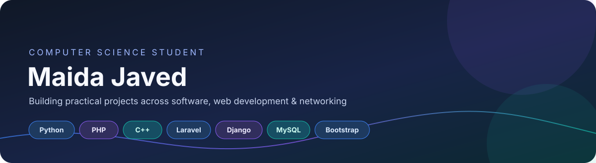
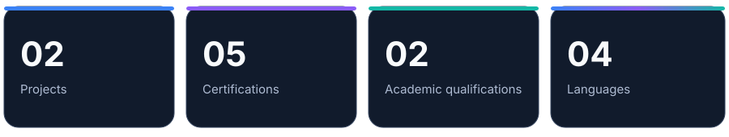
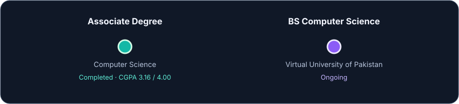

  
  
  

I believe technology is at its best when it solves real problems, simplifies everyday experiences, and creates opportunities for people. That belief drives my passion for software development and building meaningful digital solutions.

I am a **Computer Science Graduate (BSCS)** from the Virtual University of Pakistan, with practical project experience in full-stack web development, Python programming, database management, and responsive application development.

My development journey includes building solutions such as:

**Food Waste Reduction System:** Developed a full-stack web application using PHP, MySQL, JavaScript, Bootstrap, HTML, and CSS. Implemented CRUD operations, donation management workflows, interactive dashboards, normalized database structures, and role-based access control for donors and NGOs.

**Online Book Sharing Platform:** Developed a Python-based web application using Python, Django/Flask, JavaScript, Bootstrap, HTML, and CSS. Incorporated peer-to-peer book exchange, location-based search, responsive interfaces, and book inventory management.

Beyond software development, I continue exploring Artificial Intelligence, prompt engineering, Internet of Things (IoT), networking, and cybersecurity. My certifications from Cisco Networking Academy and Coursera reflect my commitment to continuous learning and staying connected with evolving technologies.

**What I bring to a team:** A problem-solving mindset, curiosity, adaptability, attention to detail, and a genuine interest in turning ideas into practical applications. I value clean development practices, thoughtful database design, user-focused functionality, and collaborative learning.

**My career goal** is to contribute to a forward-thinking technology team as a Software Developer or Full-Stack Web Developer, gain hands-on industry experience, work on real-world products, and continuously grow into an accomplished software engineer.

I am always motivated by opportunities to learn, build, collaborate, and make technology work better for people.

### Food Waste Reduction System

**Full-stack web application** | PHP, MySQL, Bootstrap, JavaScript, HTML, CSS

- Designed and implemented a CRUD-based application to streamline food donation workflows.
- Developed an interactive dashboard to monitor donation status and NGO availability.
- Implemented role-based access control for Donors and NGOs.
- Designed normalized database schemas to support donation requests.

### Online Book Sharing Platform

**Python web application** | Python (Django/Flask), HTML, CSS, Bootstrap, JavaScript

- Built a peer-to-peer book-swapping platform with modular backend structure.
- Implemented location-based search to filter book availability within geographic radii.
- Created a responsive, mobile-friendly interface.
- Developed inventory features for listing, tracking, and managing book collections.

**Backend & Programming**

**Frontend**

**Networking & Linux**

**Databases**

**Tools & Design**

Additional tools: Dev-C++, Visual Studio, MySQL Workbench, VMware, Kali Linux, Microsoft Office Suite.

| Area | Competencies |
|---|---|
| Software Development | Full-stack web development, object-oriented programming (OOP), API integration |
| Web Interfaces | Responsive design, Bootstrap-based UI development |
| Databases | SQL, MySQL, PostgreSQL, database normalization |
| Networking & Security | Network configuration (L2/L3), cybersecurity fundamentals, Linux |
| Problem Solving | Data structures and algorithms, analysis of algorithms |

### Education

- **Bachelor of Science in Computer Science** | Virtual University of Pakistan | Completed
  - CGPA: **3.01 / 4.00**
  - Relevant coursework: Artificial Intelligence, Fundamentals of Algorithms, Data Warehousing, Linear Algebra, Statistics and Probability, Theory of Automata, Digital Logic Design, Cloud Computing.
    
- **Associate Degree in Computer Science** | Virtual University of Pakistan | Completed
  - CGPA: **3.16 / 4.00**
  - Relevant coursework: Object-Oriented Programming, Data Structures and Algorithms, Computer Networks, Visual Programming, Discrete Mathematics, Software Engineering II, Web Design and Development, Relational Database Management Systems and Information Security.

### Certifications

-	Digital Awareness |	Cisco Networking Academy 
- Cyber Threat Management |	Cisco Networking Academy 
-	Introduction to Cybersecurity	|	Cisco Networking Academy 
-	Introduction to Modern AI	|	Cisco Networking Academy 
-	Prompt Like an Engineer |	Cisco Networking Academy 
-	Prompt Like an Engineer	|	Cisco Networking Academy 
-	AI for Brainstorming and Planning	| Coursera
-	AI Fundamentals |	Coursera
-	IoT for Everyone | Coursera
- Python | Coursera

### Languages

English (B2) · Urdu (Native)· Mandarin Chinese (HSK1 and HSK2) · Arabic (Basic)

- GitHub: [@MaidaJaved23](https://github.com/MaidaJaved23)

*I’m always interested in learning, building practical projects, and connecting with people in technology.*

Designed with curiosity, code, and a steady supply of tea. ☕

